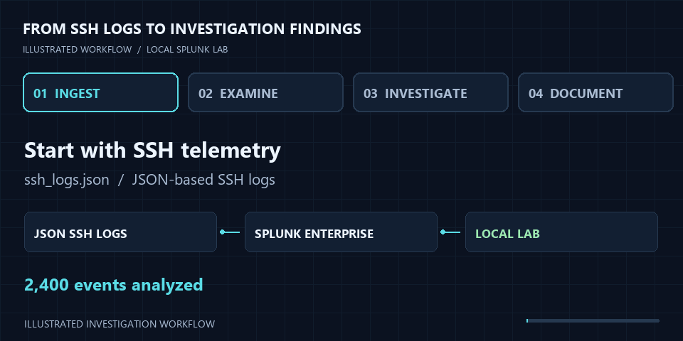

  

# SSH Authentication Log Analysis & Threat Hunting Using Splunk

An investigation of SSH login behavior using JSON-based Zeek-style logs in a local Splunk Enterprise instance. This project explores abnormal authentication activity, potential brute-force attempts, and reusable detection logic.

**[Read the investigation report](Splunk_SSH_Analysis_Report.pdf)** · [Process walkthrough](#investigation-process) · [Key findings](#key-findings) · [Lab details](#lab-details)

## At a glance

| Events analyzed | Failed authentication events | Successful authentication events | Top suspicious source |
| :---: | :---: | :---: | :---: |
| **2,400** | **1,216** | **612** | **`10.0.0.25`** |

## Investigation process

[View the static workflow](assets/process.png).

| Step | Focus | What to look for |
| :--- | :--- | :--- |
| **01 · Ingest** | Bring JSON-based SSH logs into Splunk | Authentication events available for analysis |
| **02 · Examine** | Review authentication outcomes | Failed and successful login activity |
| **03 · Investigate** | Inspect suspicious source behavior | Repeated failures, `auth_attempts`, and successful logins |
| **04 · Document** | Record findings and detection logic | An investigation that can guide future threat hunting |

## Key findings

> **Priority source: `10.0.0.25`**  
> The source exhibited highly suspicious, automated behavior, with multiple failed authentication attempts, a maximum `auth_attempts` value of **8**, and **16 successful logins**.

## Lab details

| Field | Value |
| :--- | :--- |
| Analyst | Majed Almabadi |
| Investigation date | June 19, 2026 |
| SIEM | Splunk Enterprise · local instance |
| Operating system | Ubuntu 26.04 LTS |
| Dataset | `ssh_logs.json` · 30-Days SOC Challenge Beginner, Day #18 |
| Dataset format | JSON-based Zeek-style SSH logs |
| Objective | Identify abnormal login behavior, detect potential brute-force activity, and construct reusable detection logic |

## Repository guide

- **[Investigation report](Splunk_SSH_Analysis_Report.pdf)** — the original PDF report.
- **[Visual assets](assets/)** — README banner, animated walkthrough, and static overview.
- **[Visual generator](scripts/generate_visuals.py)** — editable source for the visuals; regeneration instructions are in [assets/README.md](assets/README.md).

