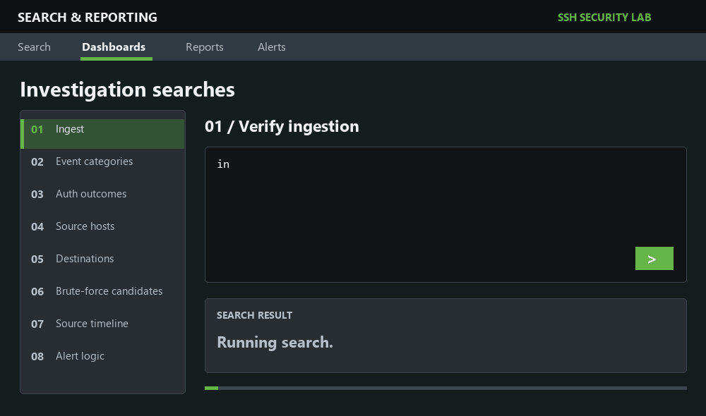
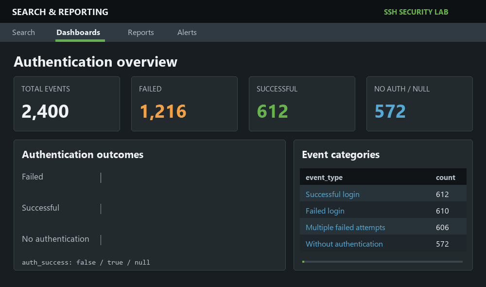
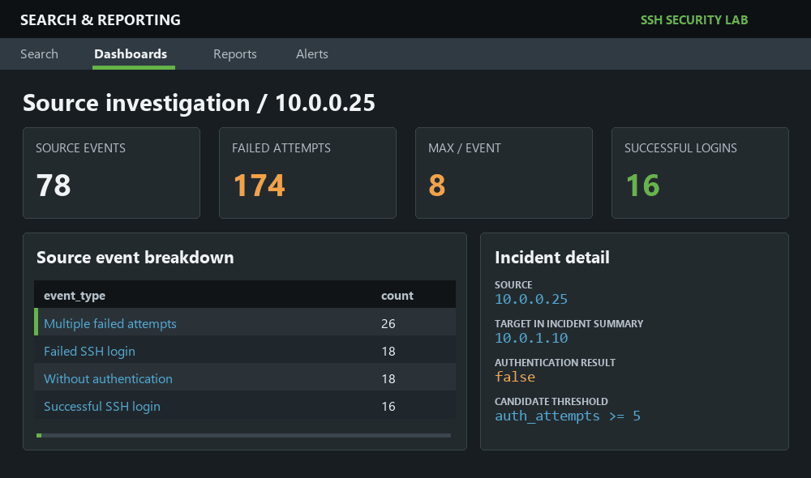

# SSH Authentication Log Analysis

An SSH threat-hunting investigation in Splunk Enterprise: explore authentication outcomes, investigate repeated failures, and build reusable detection logic. The visual walkthrough recreates the searches and findings documented in the report.

**[Open the full investigation report](Splunk_SSH_Analysis_Report.pdf)** · [Investigation steps](#investigation-steps) · [Results](#results) · [Lab details](#lab-details)

## Investigation steps

| Search | Investigation task | SPL operation |
| :--- | :--- | :--- |
| **01 · Ingest** | Verify the SSH dataset in `auth_logs` | Count searchable events |
| **02 · Categorize** | Discover SSH activity types | Count by `event_type` |
| **03 · Compare** | Review authentication outcomes | Count by `auth_success` |
| **04 · Source** | Identify the most active source hosts | Count by `id.orig_h` |
| **05 · Destination** | Identify targeted SSH servers | Count by `id.resp_h` |
| **06 · Filter** | Isolate repeated failed attempts | Filter `auth_success=false` and `auth_attempts >= 5` |
| **07 · Timeline** | Reconstruct activity from `10.0.0.25` | Sort source events chronologically |
| **08 · Detect** | Prepare reusable alert logic | Aggregate maximum attempts by source and destination |

## Results

### Authentication overview

### Suspicious source: `10.0.0.25`

### Analyst assessment

Source `10.0.0.25` generated **18 failed-login events** and **26 multiple-failure events**, alongside **16 successful logins** and **18 connections without authentication**. Failed authentication activity totaled **174 attempts**, reaching **8 attempts in a single event**. This pattern warrants investigation for potential brute-force activity and review of the successful logins.

The detection search identifies failed events with `auth_attempts >= 5` and groups candidates by source and destination. The full report includes all eight SPL searches, original Splunk screenshots, findings, and recommended controls.

## Lab details

| Field | Value |
| :--- | :--- |
| Analyst | Majed Almabadi |
| Investigation date | June 19, 2026 |
| SIEM | Splunk Enterprise · local instance |
| Operating system | Ubuntu 26.04 LTS |
| Dataset | `ssh_logs.json` · 30-Days SOC Challenge Beginner, Day #18 |
| Format / index | JSON-based Zeek-style SSH logs / `auth_logs` |
| Events analyzed | 2,400 |

## Investigation report

**[Read the Splunk SSH Analysis Report (PDF)](Splunk_SSH_Analysis_Report.pdf)**
